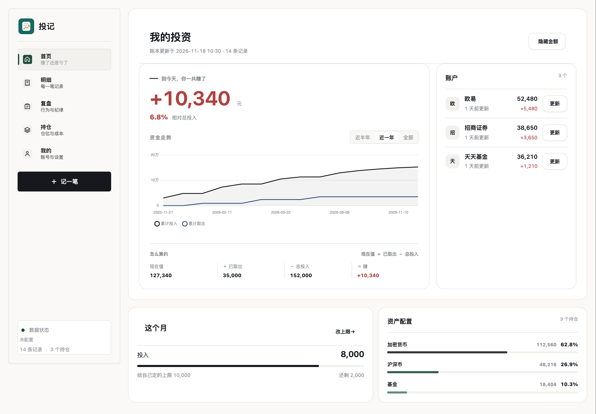
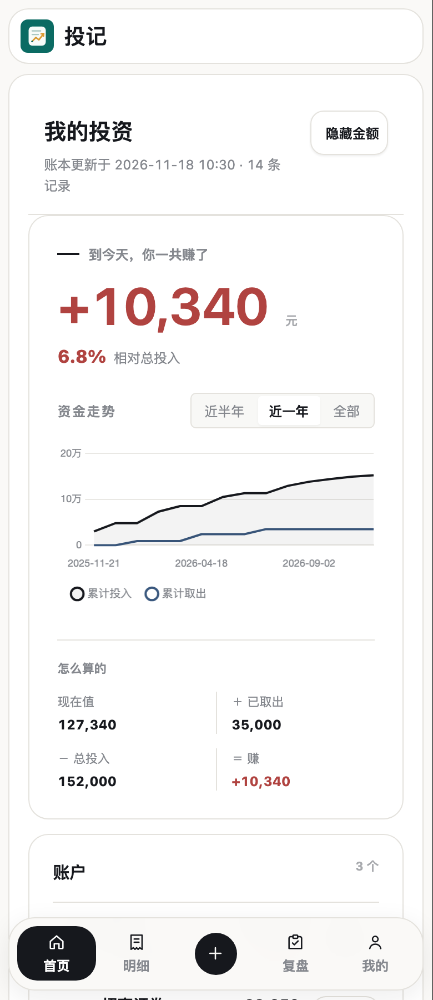
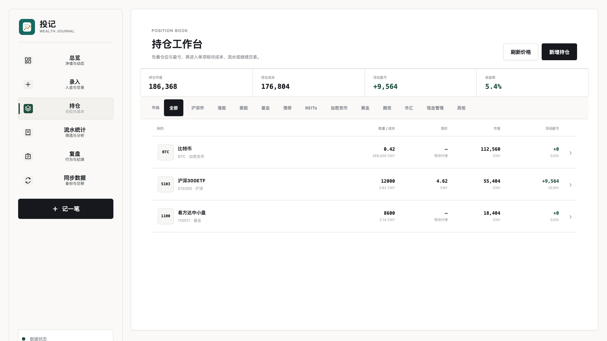

# 投记 · 个人投资记账

> 本地优先的个人投资账本：记录资金流与交易流，追踪持仓价值，看清真实净值。

[在线体验](https://stvictor-ai.github.io/FlowLedger/) · [使用路径](#现在怎么用) · [核心功能](#核心功能) · [账号同步](#个人站统一账号同步) · [只读接口](#只读接口给交易台和-agent) · [自建部署](docs/deployment/aws.md) · [迭代路线](#迭代路线)

投记是一款**本地优先**的个人投资记账工具。它帮你记录每一笔投入、取出和买卖操作，自动同步持仓数量与加权成本，按可获取的行情更新资产估值，计算持仓浮盈与已实现盈亏，最终汇总出你的**真实净值与收益率**。

它不是行情软件，也不替你下单。投记更像一个安静的投资账本：让你知道自己投了多少、取出了多少、手里还值多少。

---

## 产品预览

> 以下页面均使用匿名演示数据，不包含真实账户或个人投资记录。

### 桌面端



### 移动端与持仓

| 移动端总览 | 持仓管理 |
|---|---|
|  |  |

---

## 现在怎么用

打开网页就能用，不用注册：没登录时账本只保存在这台设备的浏览器里。在个人站登录后，账本跟着账号走，手机和电脑看到的是同一本。

手机底部（桌面左侧）是五个入口：

1. **首页**：一个数——到今天一共赚了还是亏了。下面是每个账户现在值多少、这个月投了多少。
2. **明细**：每一笔记录，按月份分组，可按年份、月份、类型、账户和关键词筛选；月度统计也在这里。
3. **记一笔**：金额、账户、钱从哪来，三样就够；日期默认今天，其余收在「更多」里。也可以用截图导入。
4. **复盘**：从日历回看每天的操作，检查规则信号，写当天的笔记。
5. **我的**：账号与同步、导入导出、恢复，以及功能开关、每月投入上限、外观和涨跌颜色。

**持仓明细**和**借款**是可选功能，在「我的 → 功能」里打开；不用的人看不到它们。

### 盈亏怎么算

不需要逐个录入持仓。每个账户填一个「现在值多少」就行：

```
盈亏 = 各账户现在值之和 + 已取出 − 总投入
```

没填现值的账户先按还放在里面的本金算（不赚不亏），首页会提示去填。

> 界面上叫「投入 / 取出 / 转移 / 借款」，账本文件和只读接口里对应的值仍是 `入金` / `出金` / `互转` / `debts`，旧数据和已接入的程序不受影响。

---

## 项目亮点

- **统一净值视角**：将投入、取出、持仓市值和已实现盈亏放在同一套计算模型中
- **资金流与交易流分层**：投入 / 取出负责本金变化，买入 / 卖出负责仓位与成本变化
- **本地优先**：静态版无需注册即可使用；个人站部署会按登录账号隔离浏览器本地副本
- **多资产、多币种**：内置沪深市、港股、美股、基金、债券、REITs、加密货币、黄金、期货、外汇、现金管理等类别
- **两种同步方式**：可选个人站统一账号 + PostgreSQL，也保留用户自己的 Private Gist
- **完整数据生命周期**：导入预览、撤销导入、自动快照、JSON 备份和冲突合并
- **轻量静态工程**：Vue 3 CDN 驱动，无构建步骤，可直接部署到静态托管
- **面向日常决策的界面**：总览、录入、持仓、明细、复盘和数据中心各自独立，支持三套主题

---

## 核心功能

### 投入与取出

- 记录向投资账户的每一笔**投入 / 取出**
- 每笔记录可记录到具体的时和分，同一天的多笔操作按实际发生时间排列
- 支持多资产类型：沪深市、港股、美股、基金、债券、REITs、加密货币、黄金、期货、外汇、现金管理、其他
- 支持多币种：CNY、USD、HKD、USDT，自动折合 CNY
- 外币投入和取出（最典型的是 C2C 买卖 USDT）记三个数：人民币金额、单价、数量。填两个，第三个自动算；三个都照订单填时互不改写
- 投入和取出可记**收付款渠道**（支付宝 / 微信 / 银行卡 / 其他）和**交易对手**（C2C 商家名）
- **从 C2C 订单截图导入**：选交易所订单列表的截图，文字在本机识别（Tesseract，截图不上传），或者把手机「复制文字」的结果粘贴进来；按固定版式解析出每笔的方向、时间、金额、单价、数量和商家，逐笔预览后导入。已有的只记了人民币的旧记录会被**补全**而不是重复新增；读错的数字靠「单价 × 数量 ≈ 金额」拦下
- 每笔换汇独立保存，不会用今天的汇率覆盖昨天的成交汇率
- 标签系统：可给每笔记录打上 `定投`、`补仓`、`FOMO` 等行为标签，便于统计和复盘
- 投入必选**资金来源**（工资 / 存款 / 借款 / 其他），借款可以关联到具体某笔贷款；取出可选**去向**（回到银行卡 / 还贷款本金 / 付贷款利息 / 其他）
- 投入前的冷静提醒留在表单里，不再弹窗：还欠着钱、本月第几笔、借来的钱、间隔太短、金额异常时才出现；风险高时要先选「这笔钱的打算」（计划内 / 补仓 / 翻本 / 抄底 / FOMO）才能保存，选的打算存成标签
- 桌面端表格内联编辑，手机端弹出 Modal 编辑

### 借款

借来的钱单独记账，不混进投入本金：

- 登记贷款：本金、年化利率、还款方式（按月付息到期还本 / 到期一次还本付息）、付息日、起息日、到期日
- 利息按银行惯例算：剩余本金 × 年化 ÷ 360 × 实际天数；按月付息的贷款到期时还要付最后一个付息日到到期日的那几天利息
- **这期该还多少**：按发薪日算每期要拿出多少；填了「每月能拿出多少」就推到每个到期日还差多少
- **待付日程**：付息、到期还本逐笔列出，付完勾一下；勾到期还本会把这笔贷款结清
- 从交易所取出来直接还贷的取出（去向 = 还本 / 付息）自动算作这笔贷款的还款，不用记两次；它仍是一笔取出，净值口径不变
- **借来的钱去了哪**：标了「借款」的投入、贷款下来以后转进交易所多少、本月投入几笔

### 买卖交易与持仓管理

- 记录**买入 / 卖出**交易，自动更新持仓数量和**加权均价**
- 卖出时自动计算**已实现盈亏**（(卖出价 − 均价) × 数量）
- 对可识别的沪深股票、港股、美股、基金和加密货币拉取最新报价；手动标的也可保留成本与数量
- 持仓工作台同时展示市值、成本、浮盈、收益率、资产占比和关联记录
- 支持从持仓详情直接继续买入或卖出，减少重复选择标的的操作
- 支持先选资产市场，再按代码 / 名称搜索；搜索不到时可手动创建自定义标的

### 明细与统计

- 记录按月份分组阅读，可一键展开、收起或定位到最新记录
- 支持按**年份、月份、类型、资产、账户、金额区间和关键词**组合筛选
- 点击任一记录可在右侧检查详情、修改或删除，不必在长表格里来回找字段
- 同一页面保留月度收支、累计净额、资产类别与账户维度统计，避免在“记录”和“统计”之间跳转

### 真实净值计算

```
真实净值 = 已取出 + 当前持仓市值 − 已投入
真实收益率 = 真实净值 ÷ 已投入 × 100%
已实现盈亏 = 所有卖出记录的盈亏之和
```

与大多数记账软件不同，投记将**资金流（投入/取出）**与**交易流（买入/卖出）**分层处理，确保统计数据不相互污染。

### 盈亏统计

- 总览：总投入、总取出、已实现盈亏、持仓市值、真实净值、真实收益率
- 周 / 月 / 年周期盈亏统计，含环比对比和累计盈亏
- 月度趋势折线图，支持按投入、取出、净盈亏、累计查看
- 本年汇总：本年投入、本年取出、本年净额、累计净额
- 按资产类型、账户、行为标签三个维度分别统计

### 行为建议与复盘

- 自动识别投入行为模式（投入间隔、密集投入次数、最大单笔等）
- 生成心理画像标签和针对性建议
- 复盘支持按近 30 天、近 90 天、近 180 天、今年或任意年份查看
- 交易日历可浏览任意历史月份，按天查看记录、交易和复盘笔记
- 行为洞察自动把近期操作与触发的规则关联起来，并给出可执行的检查建议
- 自动规则信号：大额资金变动、FOMO、亏损卖出、短期密集买入、单一持仓集中
- 每条信号都会显示触发原因和当前阈值，规则只做提醒，不替用户判断交易对错
- 支持周期复盘笔记、独立的每日复盘笔记、复盘清单和提醒规则设置
- 记录或持仓变化后，规则由浏览器本地实时重算，不需要人工或 AI 二次加工

### 界面主题

- 支持雾白、岩灰、墨金三套主题
- 主题选择保存在浏览器本地，刷新后自动恢复
- 现代财富工作台视觉：深青绿品牌色、重点收益区、分层数据卡片及移动端专属布局
- 投记专属账本图标与全端统一线性导航图标
- 桌面端使用可收起主题菜单，移动端使用紧凑主题弹层，减少常驻控件干扰
- 页面切换、菜单和提示采用轻量动效，并遵循系统的“减少动态效果”设置

### 数据管理与同步

- 数据存储在浏览器 **localStorage**，完全离线可用
- **Excel 导入导出**（含投入、取出、买入、卖出、全部记录、月度统计多个 Sheet）
- **JSON 数据备份**（包含记录、持仓与资产设置），支持合并或覆盖两种模式
- 导入前预览：自动识别新增、更新、完全重复和无效行，确认后再合并
- 导入历史：保留最近 20 次导入批次，可一键撤销
- 完整快照（记录、持仓和删除记录，最多 6 份）+ 手动快照 + 一键恢复
- **GitHub Gist 云同步**：记录、持仓和删除记录存入你的 Private Gist，免费、带版本历史、多端共享
- **个人站账号同步**：复用 Orbit 的邀请制账号与 HttpOnly Cookie，使用 PostgreSQL 持久化和 revision 并发保护
- 个人站部署按 Orbit 用户隔离 localStorage；退出后立即锁定页面，切换账号不会显示上一位用户的本地记录
- 首次关联只比较数据，不自动覆盖；可明确选择合并、上传本机或下载服务器
- 首次迁移确认后自动保存：本机立即落盘，约 1.2 秒后上传服务器；断网期间继续记录，恢复联网后自动补传

---

## 快速开始

### 方式一：直接打开（最简单）

下载整个目录后打开 `index.html` 即可。首次加载 CDN 依赖需要联网；通过 HTTPS 部署并成功打开一次后，PWA 缓存可用于离线访问。

### 方式二：部署到静态托管

直接将整个目录部署到 GitHub Pages、Netlify 或 Vercel。

**GitHub Pages 示例：**

```bash
git clone https://github.com/stvictor-ai/FlowLedger.git
cd FlowLedger
# 推送到 GitHub 后，在仓库 Settings → Pages 开启即可
```

静态托管可使用全部本地功能和 GitHub Gist 同步，但同源的“投记账号同步”需要部署下面的 Node/PostgreSQL 服务。

### 方式三：自建账号同步服务

仓库包含 Caddy、Node API 和 PostgreSQL 的 Docker Compose 配置。准备域名与 Linux 服务器后，按 [AWS 部署说明](docs/deployment/aws.md) 配置 `.env` 并启动：

```bash
docker compose up -d --build
```

正式服务只公开 80/443，PostgreSQL 不映射到公网。API 启动时自动执行数据库迁移。独立部署可继续使用投记自带账号；接入 Orbit 时设置 `IDENTITY_PROVIDER=orbit`，账号、邀请与成员统一在个人站管理。

### 方式四：手机 PWA

1. 手机浏览器打开部署后的页面
2. Safari 点击底部分享按钮 → **添加到主屏幕**
3. Chrome / Edge 点击菜单 → **安装应用** 或 **添加到主屏幕**
4. 从主屏幕打开，像原生 App 一样全屏使用，支持离线访问

---

## GitHub Gist 多端同步

投记的同步方案将数据存入你自己的 **Private Gist**，而不是公开仓库，安全且带版本历史。

**配置步骤：**

1. 打开 [GitHub Token 设置页](https://github.com/settings/tokens/new)
2. Note 随意填写（如 `touji-sync`），Expiration 按使用周期选择（建议设置有限有效期）
3. 权限只勾选 `gist`，生成并复制 Token
4. 打开投记 → **同步数据** → **云同步** → 粘贴 Token 并保存
5. **第一台设备**：点击「上传云端」完成初始化
6. **其他设备**：填入同一 Token → 点击「拉取云端」自动发现 Gist

之后可点击「智能同步」先预览本地与云端差异，再确认双向合并。冲突使用每条数据的 `updatedAt` 时间戳判断，删除也会通过删除记录同步。

> Token 只保存在配置它的浏览器 localStorage 中，不会写入代码仓库、导出文件或 Gist。复盘笔记、复盘清单和提醒规则目前只保存在各自浏览器本地。

## 只读接口（给交易台和 agent）

如果你想让本地的交易台、脚本或 AI agent 读到自己的出入金，在「同步数据 → 接口访问」里创建一个令牌即可。它**只读，不能改动账本**，随时可以撤销。默认只能读出入金；借款要在创建时单独授权。

### 拿到令牌

面板里填一个用途名称（例如"家里的交易台"）→ 创建。**令牌只显示这一次**：服务器只保存哈希，关掉就找不回来了。最多同时存在 10 个活跃令牌。

作用域（`POST /api/v1/tokens` 的 `scopes`）只有两种组合：

| scopes | 能读什么 |
|---|---|
| `["cashflows:read"]`（默认） | 出入金与互转 |
| `["cashflows:read", "debts:read"]` | 另加借款与还款 |

已有的令牌一律是 `cashflows:read`，不会自动获得借款读取权限；要读借款就新建一个。令牌列表里每个令牌都带 `scope`（空格分隔的字符串）和 `scopes`（数组）。

### 调用

```bash
curl -H "Authorization: Bearer tjk_你的令牌" \
  "https://ledger.orbitshz.com/api/v1/feed/cashflows?since=2026-01-01"
```

返回：

```json
{
  "ledger":  { "id": "…", "name": "我的账本", "revision": 41 },
  "currency": "CNY",
  "summary": { "count": 104, "totalIn": 138000, "totalOut": 35000, "net": 103000, "transferCount": 3 },
  "cashflows": [
    {
      "id": "…", "date": "2026-09-09", "time": "11:25",
      "direction": "out", "type": "出金",
      "amount": 200, "currency": "CNY", "amountCNY": 200,
      "platform": "欧易", "toPlatform": null, "assetType": null, "note": "还贷款利息", "tags": [],
      "fundSource": null, "destination": "interest", "loanId": "loan-…"
    }
  ],
  "truncated": false,
  "generatedAt": "2026-09-22T06:00:00.000Z"
}
```

要点：

- **`direction`** 是 `in`（入金）/ `out`（出金）/ `transfer`（平台间互转），带上买卖时还有 `buy` / `sell`，给程序判断用；`type` 保留中文原文，给人看。
- **互转**只是钱在自己的两个平台之间挪动：`platform` 是转出方，`toPlatform` 是转入方。它**不计入** `totalIn` / `totalOut` / `net`，只计入 `summary.transferCount`。
- **`fundSource`**（仅入金）：`salary` 工资 / `savings` 积蓄 / `loan` 借款 / `other`。
- **`destination`**（仅出金）：`card` 回到银行卡 / `repay` 还本金 / `interest` 付利息 / `other`。
- **`loanId`**：借款入金，或还本、付息的出金所关联的借款，可对上 `/debts` 里的 `id`。
- **`fxRate`**（仅外币出入金）：这一笔实际成交的单价，例如 C2C 买 USDT 时的 6.68。`amount` 是外币数量，`amountCNY` 是实际付出或到账的人民币；没记单价时按两者相除得出。人民币记录为 `null`。
- **`channel`**（仅出入金）：`alipay` 支付宝 / `wechat` 微信 / `bank` 银行卡 / `other`，入金是付款渠道，出金是收款渠道。
- **`counterparty`**（仅出入金）：交易对手，例如 C2C 商家名。
- 以上这些字段在没填、填了不认识的值、或出现在不对应的类型上时一律是 `null`。
- **`amountCNY`** 已按该笔记录的汇率折算好，调用方不需要自己处理外币。
- **`summary`** 统计的是**本次返回的这些记录**，不是整个账本——加了筛选就是筛选后的区间汇总。`net` 的含义不变：入金减出金。
- 记录按时间**升序**，删掉的记录不会出现。

### 参数

| 参数 | 说明 |
|---|---|
| `since` | `YYYY-MM-DD`，含当天 |
| `until` | `YYYY-MM-DD`，含当天 |
| `include` | `cash`（默认，出入金与互转）或 `all`（并入买入卖出；买卖不计入 summary 的收支） |
| `limit` | 1–2000，默认 2000。超出时保留**最近的**部分，并把 `truncated` 置为 `true` |

### 借款（需要 `debts:read`）

```bash
curl -H "Authorization: Bearer tjk_你的令牌" \
  "https://ledger.orbitshz.com/api/v1/feed/debts"
```

返回：

```json
{
  "ledger": { "id": "…", "name": "我的账本", "revision": 41 },
  "currency": "CNY",
  "generatedAt": "2026-10-21T06:00:00.000Z",
  "plan": { "paydayDom": 10, "monthlyPlan": 4000 },
  "loans": [
    {
      "id": "loan-…", "name": "消费贷", "lender": "招行",
      "principal": 50000, "annualRate": 0.03, "repayType": "interest_monthly", "interestDay": 20,
      "startDate": "2026-03-01", "maturityDate": "2027-03-01", "closedAt": null, "note": null,
      "repaidPrincipal": 4000, "paidInterest": 125, "remainingPrincipal": 46000,
      "repayments": [
        { "id": "r-…", "date": "2026-03-20", "principal": 1000, "interest": 125, "dueDate": "2026-03-20", "source": "salary", "note": null, "entryId": null },
        { "id": "entry:…", "date": "2026-04-20", "principal": 3000, "interest": 0, "dueDate": null, "source": "ledger", "note": "还本", "entryId": "…" }
      ]
    }
  ],
  "summary": { "count": 1, "principal": 50000, "repaidPrincipal": 4000, "paidInterest": 125, "remainingPrincipal": 46000 }
}
```

要点：

- **`repayments`** 合并了两处来源：借款里手记的还款（`entryId` 为 `null`），以及流水里关联到这笔借款的还本 / 付息出金（`source` 为 `ledger`，`id` 是 `entry:` 加流水 id，`entryId` 指回那笔流水，金额按 `amountCNY` 折算）。按日期升序。
- **`remainingPrincipal`** = 本金 − 已还本金，最低为 0；`summary` 是所有借款的合计，已结清的（`closedAt` 为毫秒时间戳）也算在内。
- `repayType`：`interest_monthly` 按月付息 / `bullet` 到期一次还本付息 / `other`；手记还款的 `source`：`salary` / `savings` / `other`。认不出的值为 `null`。
- `plan` 是还款计划（每月几号发薪、每月计划还多少），没设置时为 `null`。
- 借款按用户排好的顺序返回，其次按到期日。不分页、不按日期筛选——余额只有看整笔借款才有意义。
- 令牌没有 `debts:read` 时返回 `403 {"error":"INSUFFICIENT_SCOPE","required":"debts:read"}`。

### 自描述

`GET /api/v1/feed`（不带路径）会返回参数说明本身和令牌的 `scope`，且只列出这个令牌能调用的接口——agent 可以先读它再决定怎么调，不必外部约定。

### 部署提醒

接口住在 Node 服务里，而 GitHub Actions 那条流水线**只发静态文件**（`index.html` / `sw.js` / `manifest.json` / 图标 / `js/`）。所以前端面板会跟着 push 上线，但接口本身要在服务器上做两件事才会生效。

**一、重建容器并迁移**（生产部署在 `/opt/touji`）：

```bash
cd /opt/touji
git pull
# 这台机器用宿主机已有的 Caddy，两个 compose 文件缺一不可 ——
# 只用默认那个会丢掉 8787 的端口映射，Caddy 立刻 502。
docker compose -f docker-compose.yml -f deploy/docker-compose.existing-caddy.yml up -d --build api
docker compose -f docker-compose.yml -f deploy/docker-compose.existing-caddy.yml exec api npm run db:migrate
curl -s http://127.0.0.1:8787/api/v1/health    # 应返回 200
```

**二、在宿主机 Caddy 给 feed 开豁免**。站点块里的 `forward_auth` 没有 matcher，会挡住包括 `/api/*` 在内的一切，Bearer 令牌根本到不了应用。把需要豁免的那条路径单独 `handle` 出来：

```caddy
ledger.orbitshz.com {
    encode zstd gzip

    @feed path /api/v1/feed /api/v1/feed/*
    handle @feed {
        # 机器调用自带令牌，不走会话校验；同时剥掉客户端伪造的身份头
        request_header -X-Orbit-User-Id
        request_header -X-Orbit-User-Role
        request_header -X-Orbit-User-Email
        reverse_proxy 127.0.0.1:8787
    }

    handle {
        forward_auth 127.0.0.1:3001 { ... }   # 其余一切照旧

        @api path /api/*
        reverse_proxy @api 127.0.0.1:8787 {
            # 与 .env 的 ORBIT_PROXY_SECRET 相同；只写在登录校验之后的这一处
            header_up X-Orbit-Proxy-Secret "…"
        }
        ...
    }
}
```

改完**先验语法再 reload**，写错直接 reload 会让整个站点下线：

```bash
sudo caddy validate --config /etc/caddy/Caddyfile --adapter caddyfile
sudo systemctl reload caddy
```

只豁免 `/api/v1/feed`。创建和撤销令牌的 `/api/v1/tokens` 必须继续走会话校验——那是在浏览器里操作的。

### 关于安全

- 令牌走 `Authorization: Bearer`，服务器只存 SHA-256 哈希，**明文不落库、不写日志**。
- 作用域只有 `cashflows:read` 和 `cashflows:read debts:read` 两种，数据库层面有 CHECK 约束——借款读取必须创建时显式勾选，将来要加写权限也必须显式改 schema，不会被顺手放开。
- 响应带 `Cache-Control: no-store`，中间代理不会留副本。
- 限流 60 次/分钟。出入金本来就不是高频数据，交易台几分钟拉一次足够。
- 撤销后立即失效。怀疑泄露就撤销重建，不影响你在浏览器里的登录。

## 个人站统一账号同步

`ledger.orbitshz.com` 复用个人站 Orbit 账号，同时保留按账号隔离的 localStorage 本地副本：

1. 登录、退出、邀请和成员管理全部位于个人站 `/account`，投记不再维护第二套账号。
2. Caddy 通过个人站内部授权接口向投记 API 传递可信用户 ID 与角色；配置 `ORBIT_PROXY_SECRET` 后，API 只认同时带着代理密钥的身份头（见 [部署说明](docs/deployment/aws.md)）。在投记里停用的账号不会因为重新登录而恢复，名下令牌同时失效。
3. 每位 Orbit 用户拥有独立的 PostgreSQL 账本和浏览器本地存储分区。
4. 会话失效后，投记立即锁住该账号的账本并清空当前内存视图，但不会删除该账号的本地备份；访客账本与任何账号的本机副本分开存放。
5. 首次关联会比较本机与服务器；服务器为空时可上传，当前设备为空时会安全下载该账号的服务器副本。
6. 每次迁移前自动创建本地快照；服务器使用账本 `revision` 拒绝过期写入，避免两个设备静默互相覆盖。
7. 首次迁移确认完成后，新增、修改和删除会自动同步；发生 revision 冲突时会拉取双方较新内容、合并并重试一次。
8. 一直开着没刷新的旧页面不认识后来加的字段。客户端写入时用 `X-Touji-Schema` 声明自己的账本格式版本，服务器对版本落后的写入只接受它真正改过的内容：没动过的记录保留服务器副本，改过的记录补回它不认识的字段，它读不懂而漏掉的记录不会被当成删除。页面回到前台时会检查线上版本，有新版就提示刷新。
9. 断网时数据仍会立即保存在当前设备，联网、切回页面或定时检查时会自动补传。手动“比较并同步”仍保留作恢复入口。

个人站版本不登录也能使用：没登录过的设备直接按访客打开，账本只保存在这台设备的浏览器里，不上传；登录后才保存到云端并多端同步，这台设备上第一次登录时，已经记在本机的内容会一起带进账号。登录过的设备会话失效时会提示重新登录，也可以选择先不登录、另记一本；连不上服务器（不是登录失效）时会打开该账号留在本机的副本，联网后再同步。

这要求宿主机 Caddy 只对 `/api/*` 做登录校验、静态文件公开，见 [部署说明](docs/deployment/aws.md)。GitHub Pages 与本地 `index.html` 仍是独立的本地模式。

---

## 数据模型

### 记录（entry）

```js
{
  id,            // UUID
  date,          // "YYYY-MM-DD"
  time,          // "HH:mm"，旧记录可为空
  amount,        // 原始金额（数字）
  rate,          // 对 CNY 汇率（空 = 1）
  exchange,      // 账户 / 平台名称
  note,          // 备注
  type,          // "入金" | "出金" | "买入" | "卖出"
  assetType,     // "沪深市" | "港股" | "美股" | "基金" | "债券" | "REITs" | ...
  currency,      // "CNY" | "USD" | "HKD" | "USDT"
  tags,          // 行为标签数组，如 ["定投", "FOMO"]
  // 人民币换入外币时保存交易两侧，普通记录可为空
  sourceAmount, sourceCurrency, // 例如 500 CNY
  targetAmount, targetCurrency, // 例如 74.183976 USDT
  fxRate,        // 本笔实际汇率，例如 1 USDT = 6.74 CNY
  // 买入/卖出专用字段
  tradeQty,      // 成交数量
  tradePrice,    // 成交单价（原始币种）
  targetSymbol,  // 标的代码
  targetName,    // 标的名称
  positionId,    // 关联的持仓 ID
  realizedPL,    // 已实现盈亏（仅卖出记录，CNY）
  // 资金口径（可选）
  fundSource,    // 入金：'salary' | 'savings' | 'loan' | 'other'
  destination,   // 出金：'card' | 'repay' | 'interest' | 'other'
  loanId,        // 借款入金 / 还贷出金关联的贷款 id
  channel,       // 出入金的收付款渠道：'alipay' | 'wechat' | 'bank' | 'other'
  counterparty   // 交易对手，例如 C2C 商家名
}
```

### 负债（debt）

```js
// 贷款
{
  id, kind: 'loan',
  name, lender,
  principal,     // 原始本金（CNY），剩余本金由还款算出
  annualRate,    // 0.03 = 3%
  repayType,     // 'interest_monthly' | 'bullet' | 'other'
  interestDay,   // 按月付息的付息日（1-31）
  startDate, maturityDate,
  closedAt, note, sortOrder,
  repayments: [{ id, date, principal, interest, dueDate, source, via, note }],
  updatedAt
}
// 还债计划（每个账本最多一条）
{ id: 'debt-plan', kind: 'plan', paydayDom, monthlyPlan, nudge, updatedAt }
```

### 持仓（position）

```js
{
  id,            // UUID
  symbol,        // 代码（如 "600519"、"BTC"）
  name,          // 名称（如 "贵州茅台"）
  qty,           // 持有数量
  avgCost,       // 加权均价（原始币种）
  currency,      // "CNY" | "USD" | "HKD" | "USDT"
  assetType,     // 资产类型
  source,        // "eastmoney" | "binance" | "manual"
  secid,         // 东方财富行情 ID（用于拉取实时价格）
  icon,          // 可选图标
  origin,        // "manual" | "trade"
  updatedAt      // 多端同步冲突判断时间
}
```

---

## 技术栈

| 技术 | 用途 |
|------|------|
| Vue 3 (CDN) | 响应式 UI 框架 |
| Chart.js (CDN) | 月度趋势图、持仓配置图 |
| SheetJS/xlsx (CDN) | Excel 导入导出 |
| Day.js (CDN) | 日期处理 |
| localStorage | 本地数据持久化 |
| GitHub Gist API | 云端多端同步 |
| Node.js + Express | 邀请注册、会话和账本同步 API |
| PostgreSQL | 多用户隔离、账本持久化与 revision 事务 |
| Docker Compose + Caddy | 同源 HTTPS 部署、反向代理与服务编排 |
| PWA (manifest + sw.js) | 离线缓存与主屏幕安装 |
| 东方财富 API | 股票 / 基金实时报价与搜索 |
| Binance API | 加密货币实时报价 |

前端仍以 `index.html` 为入口，无构建工具，可直接部署；`server/` 是独立可选的 Node 服务，不影响纯静态模式。

---

## 项目结构

```
FlowLedger/
├── index.html        # Vue 主应用与界面
├── js/
│   ├── entry-engine.js   # 流水时间排序、逐笔换汇与 CNY 折算
│   ├── import-engine.js  # 导入规范化、预览与多重集去重逻辑
│   ├── review-engine.js  # 无框架依赖的复盘规则、日历与时间线引擎
│   └── server-sync.js    # 投记账号认证与 revision 同步客户端
├── server/               # Express 模块化单体、PostgreSQL 迁移与测试
├── deploy/               # Caddy 与静态前端容器配置
├── ops/                  # PostgreSQL 备份和显式恢复脚本
├── tests/
│   ├── entry-engine.test.js # 时间、换汇精度与旧数据兼容测试
│   ├── import-engine.test.js  # 导入合并与重复记录测试
│   ├── review-engine.test.js  # 复盘规则、日历与时间线测试
│   └── server-sync.test.js    # 账号同步客户端测试
├── docs/             # 架构决策、实施计划与部署说明
├── docker-compose.yml # Web、API 与 PostgreSQL 编排
├── manifest.json     # PWA 配置
├── sw.js             # Service Worker 离线缓存
├── icon-192.png      # PWA 图标
├── icon-512.png      # PWA 图标
├── icon.svg          # 图标源文件
├── screenshots/      # 匿名演示数据生成的 README 截图
├── deploy.sh         # 可选服务器部署脚本
└── README.md
```

---

## 产品理念

> 投资的本质是把钱交给时间。记账的本质是把感觉交给数字。

投记的核心原则：

- **本地优先**：浏览器始终保留可独立使用的账本；账号同步和 Gist 都是用户主动选择的能力
- **两层分离**：现金流（入金/出金）和交易流（买入/卖出）独立统计，净值算得准
- **轻量优先**：客户端始终是一个可独立运行的单文件；不部署服务器、不注册账号，也能完整使用

---

## 隐私与安全

- 流水、持仓、同步配置默认存储在当前浏览器的 `localStorage`
- 只有主动使用 Gist 同步时，流水、持仓和删除记录才会发送到用户自己的 Private Gist
- 只有登录自建投记账号并确认迁移后，流水、持仓和删除记录才会写入该服务器的 PostgreSQL
- 账号密码使用 Argon2id 哈希，会话使用 HttpOnly Cookie；服务器管理员仍可访问数据库明文，因此当前版本不是端到端加密
- GitHub Token 只保存在配置它的浏览器中，不写入仓库或导出的业务数据
- README 截图来自匿名演示账本，不包含作者的真实账户、持仓或流水
- 公开演示前可开启“隐藏金额”，避免在屏幕分享时暴露真实数值

> 浏览器本地数据仍可能因清理缓存或更换设备而丢失，请定期下载 JSON 备份。

---

## 迭代路线

### P0 · 先把账算得更稳

- 为净值、加权成本、卖出盈亏、导入合并和同步冲突继续补齐自动化测试
- 为 localStorage 数据模型增加显式版本号和可回滚迁移
- 增加行情源健康检查、失败提示、缓存价格与备用报价源
- 在已拆出的 `review-engine.js` 基础上，继续拆分计算、存储、同步、行情和 UI 模块
- 接入 GitHub Actions，自动执行语法检查、核心测试和 Pages 部署验证

### P1 · 补齐专业投资指标

- 增加 XIRR 资金加权收益率和 TWR 时间加权收益率
- 支持沪深 300、标普 500、比特币等基准对比
- 记录手续费、税费、分红、利息和资产转移
- 展示目标配置、实际配置与仓位偏离提醒
- 增加净值曲线、最大回撤、波动率和月度收益热力图

### P2 · 让复盘真正有用

- 支持自定义复盘模板、投资规则与执行评分
- 在现有五类规则信号上增加连续追高、计划偏离和仓位变化趋势
- 将每日复盘笔记、清单和提醒规则纳入可选的多端同步与 JSON 备份
- 提供隐私模式下可分享的只读复盘卡片

### P3 · 从个人工具走向公共产品

- 邀请制账号与 PostgreSQL 同步已进入 v1，下一步完成 AWS 试运行、备份恢复演练和小规模用户验证
- 将 GitHub Token 配置升级为更友好的 OAuth 授权流程
- 支持多账本、多投资组合和家庭资产视图
- 完成中英文界面、无障碍与键盘操作
- 增加隐私友好的错误监控与匿名产品指标
- 发布稳定版本、变更日志、贡献指南和公开产品路线图

### 推荐顺序

下一阶段建议先完成 **自动化测试 + 数据迁移 + XIRR/TWR**。这三项既能降低账本类产品最关键的数据风险，也最能体现项目在求职作品中的工程深度。账号系统、AI 建议和更多行情源可以放在核心账务可靠之后。

---

## License

MIT
